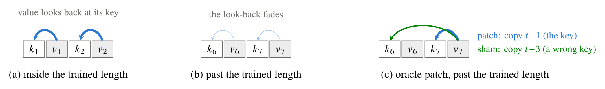
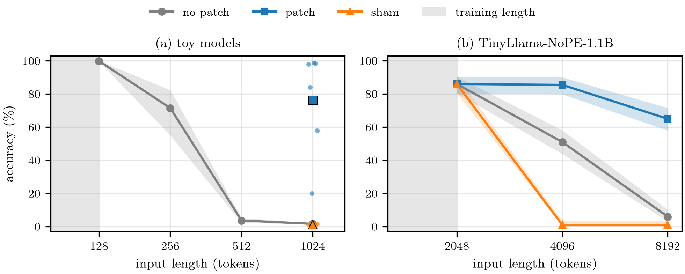
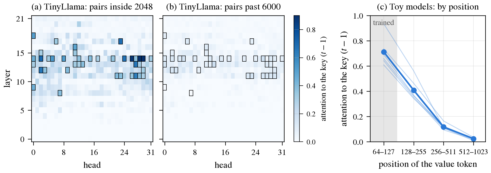
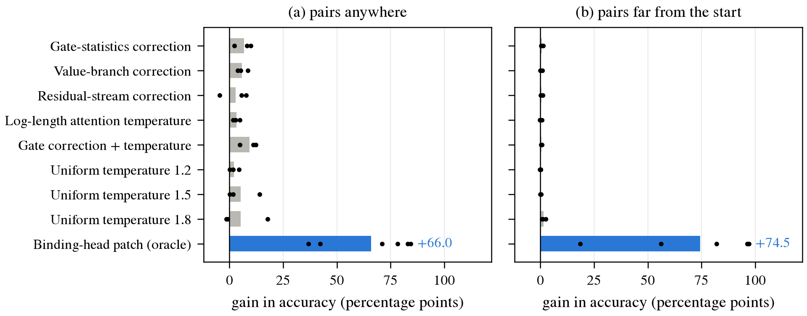
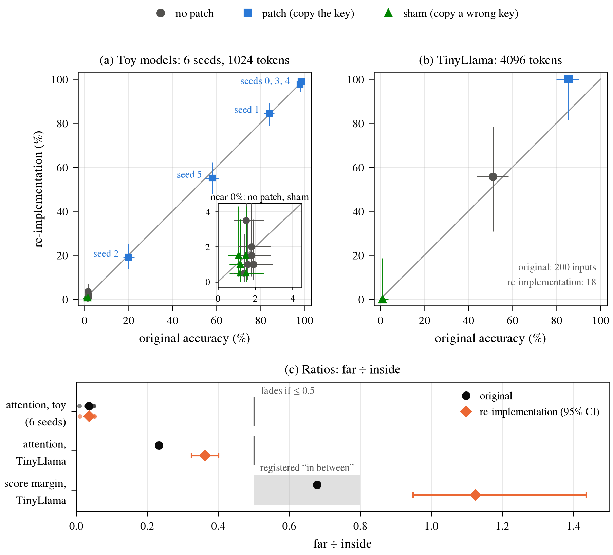

# gate-length-pilot

**Figure 1.** Selected heads attend from each value to the key just before it; past the trained length that attention falls, and the oracle interventions overwrite those heads' output.

Details

- Schematic in the toy token layout (`key value key value …`). In TinyLlama each pair is `key value newline`, so its sham copies $t-4$.
- The patch replaces the selected heads' attention output (before the output projection), at value positions past the trained length, with the attention-value vector at $t-1$. It does not change the attention weights. The sham does the same with $t-3$. They are separate runs, never combined.
- "Selected heads" (called binding heads elsewhere in this repo): heads whose value tokens give at least 0.3 of their attention to $t-1$ inside the trained length.

**Figure 2.** Past the trained length retrieval falls toward chance in both models; the oracle patch raises it to 76.1% (toy, mean of 6 seeds) and 65.0% (TinyLlama, 4×), while the wrong-key sham lowers it.

Details

- Pairs far from the start of the input ("before" placement), so the distance from pair to query matches training.
- (a) Toy models, 1.1M parameters, trained on at most 128 tokens. Chance 1.6% (64 possible values). No patch: mean of 3 training seeds, 1000 test inputs each; the band is the range. Patch and sham were tested at 1024 tokens only, on 6 seeds (3 trained fresh for this test), 1000 inputs each. Dots are seeds and the marker is their mean. The seeds' patched accuracy spans 20–99%.
- (b) TinyLlama-NoPE-1.1B, one checkpoint, 200 inputs per point. Accuracy is the argmax over 512 candidate value words (chance 0.2%); over the full vocabulary the patch reaches 25.5% at 8192. Bands are exact 95% binomial intervals over inputs, not over models.
- No patch here is the rerun scored one input at a time, like patch and sham, so all three match exactly at 2048. The registered batch-of-4 baseline was 84.5 / 51.0 / 6.5% ([RESULTS-6.md](RESULTS-6.md)).

**Figure 3.** The selected heads' attention to the key falls sharply past the trained length: 0.46 → 0.11 in TinyLlama, 0.71 → 0.02 in the toy models.

Details

- Each cell: attention from the block's 16 value tokens to the token before them, averaged over 64 inputs. (a) Pairs anywhere inside a 2048-token input. (b) Pairs past position 6000 of an 8192-token input. One color scale, 0–1.
- Outlined: the 39 heads with at least 0.3 in (a). Selection and (a) use the same 64 inputs, so (a) is selection-conditioned. The measurement adds a bfloat16 rounding the model itself does not apply ([RESULTS-6.md](RESULTS-6.md), Limitations).
- (c) Each seed's selected heads (4–6 per seed, chosen at positions 64–127 on the same inputs), averaged; thin lines are the 6 seeds.
- A smaller share does not by itself show the key is harder to tell apart: more tokens compete as the input grows. Why it falls is open; the score-margin test meant to decide this did not reproduce (Figure 5).

**Figure 4.** In the toy models at 8× the trained length, eight tested corrections gain at most 1.4 points on far-away pairs; the oracle patch gains 74.5.

Details

- Toy models at 1024 tokens. Each gain is accuracy with the intervention minus accuracy without it, on the same checkpoint and test inputs. Baselines in the panel titles are for the corrections' test set.
- Corrections (pilots 1–2): training seeds 0–2, 1000 inputs each. The patch (pilot 4): seeds 0–2 (the same checkpoints, filled dots) and 3 fresh seeds (open dots), on pilot 4's own random draw of test inputs (baselines 11.0% and 1.7%).
- "Logit scale ×λ" multiplies every attention logit by λ, so λ > 1 sharpens attention. Log-length scaling multiplies the logit at position $t$ by max(1, ln(t+1) / ln 128). These are the settings tested here, not every variant: Wang et al. (2024) also tune per-head scales, which were not tested.
- The patch is an oracle: it is told which heads and positions to fix. It shows where the failure is, not a usable method.

**Figure 5.** Re-implemented separately, the toy accuracies agree closely, TinyLlama's rescue and attention drop agree qualitatively, and TinyLlama's predicted margin decline does not reproduce.

Details

- A separate AI (Codex) wrote its own task, head selection, measurement and patch code from the pre-registrations, before seeing this code or its results. It reused the same model checkpoints (toy models were not retrained). Write-ups: [AUDIT.md](AUDIT.md), [AUDIT-2.md](AUDIT-2.md).
- (a) Toy models at 1024 tokens: one point per training seed and condition (6 × 3), labeled by seed for the patch. Original 1000 inputs per seed, re-implementation 200. The inset zooms on the no-patch and sham points near 0%.
- (b) TinyLlama at 4096 tokens: original 200 inputs, re-implementation 18, in float32 on a CPU. The re-implementation patched only 2 TinyLlama inputs at 8192, too few to show.
- Bars in (a) and (b) are exact 95% binomial intervals.
- (c) Ratios of the far mean to the inside mean over the selected heads. Attention: share on $t-1$. Score margin: the attention logit of $t-1$ minus the mean logit of the other earlier tokens (the original code also counted the value token itself, a disclosed deviation in [PREREGISTRATION-6.md](PREREGISTRATION-6.md)). Re-implementation intervals are a paired bootstrap over its 4 diagnostic inputs; the original saved only averages, so it has no interval. Registered rules: attention fades if the ratio is at most 0.5 (D1); the margin is "in between" from 0.5 to 0.8 (D1b).

[Overview, verdicts and how to reproduce](OVERVIEW.md) · figures: `python readme/build.py`
