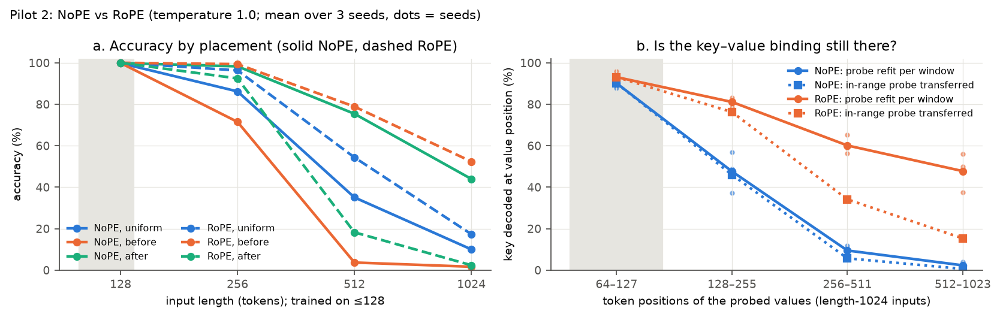
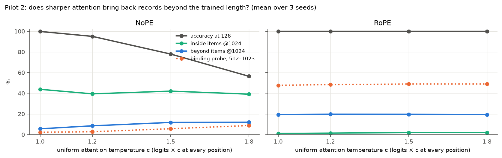

# Pilot 2 results: why are records beyond the trained length lost?

**Pre-registered verdict: MIXED.** The evidence leans toward *lost positional information* over *attention
distraction* in the NoPE model, but the pre-registered rule did not produce a clean POSITION LOSS verdict:

- No temperature rescued the lost records (R failed).
- The RoPE control also lost some binding far from the start (P3 failed in one of three seeds).
- One temperature setting broke the probe even inside the range (P1 failed in one of twelve cells).

Plan and decision rule: [PREREGISTRATION-2.md](PREREGISTRATION-2.md) (signed commit `81c52d5`, before any data).
Full tables: [results2/decision.md](results2/decision.md). Compute: 0.76 GPU-hours on one RTX 3090 (≈ $0.14).

## Question

Pilot 1 found that in the NoPE model, records placed beyond token position 128 are lost. Two explanations compete:

- **Position loss.** NoPE's only position signal comes from the causal mask and fades with length. Past 128 the
  model can't tie a value to the key just before it (the *binding*).
- **Attention distraction** (Wang et al., 2024). The information is there but attention spreads too thin, and
  sharper attention would fix it.

Tests:
1. a linear probe that tries to decode, at each value position, the key just before it;
2. Wang et al.'s uniform attention temperatures (1.0 / 1.2 / 1.5 / 1.8 at every position, none tuned);
3. a RoPE control model (3 seeds, same recipe) that gets explicit relative positions.

## What happened



**1. Opposite failures.** The two models fail on opposite placements (fig. 7a, accuracy at 1024):

| placement | what it stresses | NoPE | RoPE |
|---|---|---|---|
| *before*: relevant record pushed far from the start, near the query | absolute position | 1.6% | 52.4% |
| *after*: relevant record stays early, far from the query | distance | 44.0% | 2.4% |

NoPE fails on absolute position. RoPE fails on distance, which matches its known problem with relative distances
never seen in training (LM-Infinite). Both models solve length 128 (NoPE 99.8%, RoPE 100%).

**2. NoPE loses the binding past the trained length** (fig. 7b, best layer, mean of 3 seeds):

| token positions | 64–127 | 128–255 | 256–511 | 512–1023 |
|---|---|---|---|---|
| NoPE, probe refit in each window | 90.1% | 47.6% | 9.5% | 2.3% |
| NoPE, in-range probe transferred | 90.1% | 46.0% | 5.7% | 0.6% |
| RoPE, probe refit in each window | 93.1% | 81.1% | 60.1% | 47.8% |
| RoPE, in-range probe transferred | 93.1% | 76.2% | 34.1% | 15.3% |

Chance is 0.2%. The layer-0 control sits at chance, as it should.

- **NoPE:** even a probe retrained on the far positions decodes almost nothing (0.3–3.9% per seed). So the
  binding is not *linearly decodable* far away, which is more than a change of linear format. A linear probe
  cannot show that the information is absent; non-linearly stored information would be missed (`AUDIT.md`, issue 3).
- **RoPE:** keeps half the binding far away, but in a shifted format. The retrained probe gets 48%, while the
  in-range probe transferred to the same positions gets 15%. One RoPE seed keeps only 37.5% against 96% in range,
  which is below the pre-registered "at least half" bar. That is why P3 failed.



**3. Sharper attention did not bring the records back** (fig. 8). Across temperatures 1.2–1.8, beyond-range
accuracy at 1024 rose by only +3 to +6 pp on average, against the 20 pp bar. One seed gained 15–19 pp; the other
two gained 0–3 pp. Sharpening also costs accuracy at the training length: 99.8% → 95.1% → 78.0% → 56.5%. At
c = 1.8, one seed's in-range binding collapsed to 1.7%, so the probe could not compare inside with far. That
single cell is what made P1 fail. In the other 11 seed × temperature cells, far-away binding was below half of
in-range binding. RoPE was unaffected by temperature.

## Reading it honestly

- What the data support: in this NoPE model, past the trained length the key–value binding is no longer
  linearly decodable, and a standard attention-sharpening fix does not restore it. That fits *position loss*
  better than *attention distraction*.
- What they don't support: a clean claim that this is specific to NoPE's implicit positions. RoPE's binding also
  fades with distance from the start (in a different, partly recoverable form), and the pre-registered rule says
  MIXED. Treat "position loss" as the leading hypothesis, not a result.

## Limitations

- **Probe:** linear (ridge). Non-linear information could be missed. The in-range probe works (90%+) and a probe
  retrained at far positions also fails for NoPE, but neither rules out a non-linear code far away. The MLP
  fallback only triggers when the in-range probe fails, so it never tested the far positions.
- **Independent audit:** `AUDIT.md` reproduces this pilot's verdict from the saved results and spot-checks saved
  predictions against the checkpoints (no mismatches).
- **Temperature:** four uniform values only. Wang et al. also train per-head scales on long data, which was not
  tested.
- **RoPE control:** trained with the recipe tuned for NoPE. Heads that look across distances never seen in
  training may be what blurs its far-away binding; that is untested.
- **Scale:** three seeds, one tiny model and one synthetic task. NoPE seed 2 behaves differently (biggest
  temperature gain, highest baseline).

## How this relates to prior work

- **Wang et al. (2024):** uniform temperature extends NoPE language models. Here it did not rescue binding on a
  precise retrieval task, and it hurt in-range accuracy.
- **Kazemnejad et al. (2023); Dawes et al. (2026):** NoPE's implicit position comes from the causal mask and
  fades with length. This pilot measures a consequence consistent with that on a retrieval task: past the trained
  length, the key–value binding stops being linearly decodable.
- **LM-Infinite (Han et al., 2024):** relative distances never seen in training break RoPE models. RoPE's
  failure on the "after" placement here fits that.
- **Han & Ji (ACL 2025):** attention logits split roughly into a positional part plus a semantic part. The two
  models' opposite failures here (absolute position for NoPE, distance for RoPE) show the positional part
  failing in two different ways.

## Reproduce

```bash
python train.py --seed 0 --pos rope --steps 60000 --curriculum 0.5 --out runs_rope   # seeds 0, 1, 2
python pilot2.py --seed 0                      # NoPE (pilot-1 checkpoints); seeds 0, 1, 2
python pilot2.py --seed 0 --runs runs_rope     # RoPE control
python report2.py                              # fig7, fig8, results2/decision.md
```
