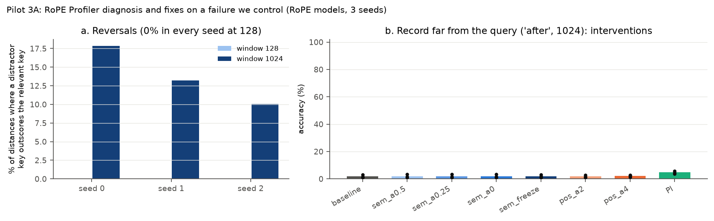
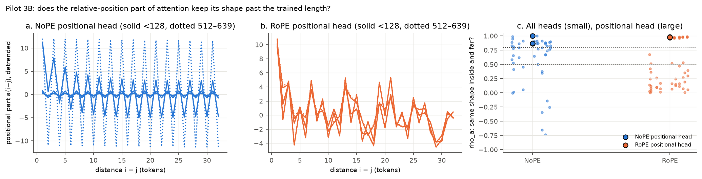

# Pilot 3 results: two targeted tests on the trained models

Plan and decision rules: [PREREGISTRATION-3.md](PREREGISTRATION-3.md) (signed commit `1ac4b35`, before any data).
Full tables: [results3/decision.md](results3/decision.md). No retraining. Compute: about 15 minutes on one rented
RTX 3090 (≈ $0.05).

| test | paper author | pre-registered verdict |
|---|---|---|
| A. Does RoPE Profiler diagnose and fix a failure we control? | Hao Peng | **DETECTS BUT DOES NOT FIX** |
| B. Does attention's relative-position part keep its shape past the trained length? | Heng Ji | **NO BREAK IN NOPE** |

## A. RoPE Profiler on a known failure (Wu, Du & Peng, 2026)



The RoPE models fail when the relevant record is farther from the query than any distance seen in training
(the "after" placement: 1–3% at 1024). The retrieval heads were picked automatically. In every seed they were
two layer-3 heads putting about 98% of the query's attention on the relevant record's value token.

- **The diagnostic detects it.** Inside the trained window, the relevant key never loses to a distractor (0% of
  distances). Over a 1024 window it loses at 10–18% of distances. Their semantic score drops from 1.00 to
  0.85–0.91, and all three seeds point to *semantic reversal* as the worse failure.
- **Their fix doesn't reach it.** Attenuating, removing or freezing the high-frequency band, or amplifying it,
  changes accuracy by at most +0.3 pp. Standard position interpolation, a reference fix that is not theirs, adds
  only +2.8 pp, and it collapses the "before" placement from 52% to 3%.
- **Reading:** removing the high-frequency band entirely changes nothing, so the reversals here likely come from
  the slow-rotating components, which never complete a turn within 128 tokens. Their theory and their fix are
  about high-frequency share within a trained window. Beyond the window, the diagnosis still works but the lever
  is in a different band. That is a hypothesis; which band carries the reversals was not measured directly.
- **Open question it raises:** is there a counterpart intervention when the reversal comes from components that
  never completed a rotation in training?

## B. Han & Ji's decomposition in a NoPE model (ACL 2025)



- **The decomposition holds in NoPE too.** The three-axis fit a(i−j) + b(i) + c(j) explains NoPE attention scores
  well inside the trained range: mean correlation over heads 0.76–0.85, higher than RoPE's 0.45–0.51 on this task.
- **The positional part does not break.** The most positional head keeps the same profile far away (rho 0.86–1.00
  in NoPE, 0.97–0.99 in RoPE), so the pre-registered verdict is NO BREAK IN NOPE. That cuts against the simplest
  form of pilot 2's leading hypothesis, that the NoPE model can no longer *find* the token just before a value.
- **Exploratory, not pre-registered: far away, position takes over in NoPE.** NoPE's positional profile keeps its
  shape but roughly doubles in amplitude (fig. 10a). Across all heads, the position-only part's share of
  attention-score variance jumps from about 0.03–0.15 inside to 0.3–0.8 far away in many NoPE heads. RoPE's
  shares stay flat. One reading that fits pilots 2 and 3 together: past the trained length, NoPE attention
  becomes mostly about *distance* and less about *which token*, and the key–value binding blurs. This is a
  hypothesis to test, not a result.
- **Open question it raises:** Han & Ji explain length-extrapolation methods as keeping attention outputs in
  distribution. Here the position part's *shape* stays in distribution while its *weight* relative to content
  grows. Is that imbalance what Λ-shaped masks and attention scaling correct?

## Limitations

- Small models, one synthetic task, three seeds per model.
- RoPE Profiler was re-implemented from the paper's equations, not run from its code. Its 49-task rank comparison
  was replaced by a raw 128-vs-1024 comparison.
- The band cut, the α grid and the two-head choice were fixed in advance but are judgment calls.
- In B, the "positional head" picked by the rule is not always the head that forms the binding in pilot 2's
  probes. The all-head pattern is exploratory.

## Reproduce

```bash
python pilot3.py a --seed 0                    # RoPE models; seeds 0, 1, 2
python pilot3.py b --seed 0 --runs runs        # NoPE
python pilot3.py b --seed 0 --runs runs_rope   # RoPE
python report3.py                              # fig9, fig10, results3/decision.md
```
