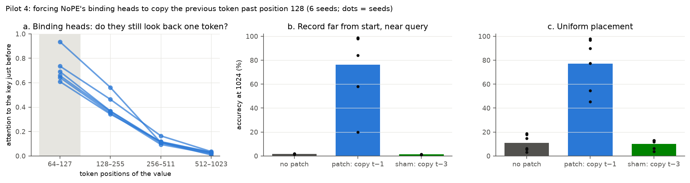

# Pilot 4 results (final): the binding heads are the bottleneck

**Pre-registered verdict: BINDING ATTENTION IS THE BOTTLENECK.** D1 and D3 held in every one of the six NoPE
seeds, including three fresh seeds that played no part in suggesting the hypothesis. D2 is an across-seed
criterion. The mean gain (+74.5 pp) cleared its 20 pp bar and every seed's CI was above zero, but seed 2 alone
gained only +18.6 pp.

In the NoPE model, the heads that tie each value to the key just before it look at that key much less once
positions pass the trained length. Forcing them to look there restores most retrieval. *Why* their attention
fades is not settled by this pilot (see point 2).

**Independent check:** a separate AI (Codex, OpenAI) re-implemented this experiment from the registration alone,
without seeing this code or these results first. It got the same numbers seed by seed (patch 75.7% vs 76.1% here;
see [AUDIT.md](AUDIT.md)).

Plan, decision rule and the hard stop: [PREREGISTRATION-4.md](PREREGISTRATION-4.md) (signed commit `571a707`,
before any data). Full tables: [results4/decision.md](results4/decision.md). Compute: about 45 minutes on one
rented RTX 3090 (≈ $0.20). This is the last experiment in the series.



## What was found

| | none | patch (copy the token before) | sham (copy a wrong key) |
|---|---|---|---|
| attention of binding heads to the token before, positions 64–127 → 512–1023 | 0.61–0.94 → 0.01–0.04 | – | – |
| "before" @1024 (record far from start, near query) | 1.7% | **76.1%** | 1.3% |
| uniform @1024 | 11.0% | **77.0%** | 10.1% |
| binding probe, positions 512–1023 | 3.0% | **99.0%** | 0.5% |
| uniform @128 (identity check) | 99.9% | 99.9% | 99.9% |

The table shows means over six seeds. The patch's gain on "before" @1024 was +96, +82, +19, +97, +97 and +56 pp
by seed. Every seed's bootstrap CI lies above 0, and the patch beats the sham by +75 pp on average.

1. **Binding heads exist and are easy to find.** Every seed has 4–6 heads, in layers 2–3, that put a large share
   of a value token's attention on the key just before it. Averaged over each seed's selected heads this is
   0.6–0.9; single heads range from 0.30 to 0.95. That is how the model records "this value belongs to that key."
2. **That attention fades with absolute position** (fig. 11a). Head averages are 0.6–0.9 inside the trained range,
   about 0.35–0.55 at 128–255, about 0.1 at 256–511, and 0.01–0.04 at 512–1023. Two different causes would
   produce this drop, and this pilot does not separate them:
   - the heads' *preference* for the previous token weakens, as a fading implicit position signal predicts;
   - the preference stays the same but is diluted by more competing tokens. A fixed score advantage still loses
     attention share as the sequence grows (`AUDIT.md` issue 2).

   In seed 1, pilot 3B's "most positional" head is itself one of these binding heads, so pilot 3B's stable profile
   did not reflect intact look-back.
3. **Restoring it restores the computation** (fig. 11b–c). Copying the right token brings retrieval of far
   records from about 2% to 76% on average, and the binding probe from 3% to 99%. Copying a wrong key does
   nothing, so the effect comes from restoring the *right* information, not from any change at all.
4. **Not everything is restored.** In two seeds the patch recovers only +19 and +56 pp, so part of the failure
   lies outside the patched heads. D3 shows the *key* becomes decodable again. It does not show where the rest of
   the error sits: the query's read-out (which pilot 1 found degrades at long lengths) or another part of the value
   pathway (`AUDIT.md` issue 7).
5. *Descriptive, a hypothesis:* under the "after" placement, the patch and the sham both raise accuracy
   (45% → 75%). One possible reading is that blurred bindings far away act as false matches for the query, and
   clean bindings of any kind remove that interference. This was not tested directly.

## How this ties the four pilots together

| pilot | question | verdict |
|---|---|---|
| 1 | Does correcting SwiGLU gate statistics fix long inputs? | **ABANDON**: small, not gate-specific |
| 2 | Lost positional information or attention distraction? | **MIXED**: no temperature rescue; binding decays (RoPE partly too) |
| 3A | Does RoPE Profiler (Hao Peng's group) diagnose and fix a failure we control? | **DETECTS BUT DOES NOT FIX** |
| 3B | Does Han & Ji's positional part keep its shape far away in NoPE? | **NO BREAK**, but the measure is confounded by key/value alternation |
| 4 | Is the lost binding caused by the previous-token heads' attention? | **BINDING ATTENTION IS THE BOTTLENECK** |

The story that survives all four, with its open part marked: in this NoPE model, failure past the trained length is
mainly a failure of the heads that bind each value to its preceding key.
- Their look-back attention collapses past the trained length, and restoring it restores most retrieval. Neither
  the feed-forward statistics corrections (pilot 1) nor a global attention temperature (pilot 2) reached that.
- *Why* the attention collapses is still open. One possibility is a fading implicit position signal, as the theory
  that NoPE's positions come from the causal mask predicts (Kazemnejad et al., 2023; Dawes et al., 2026). The other
  is dilution of an unchanged preference by more competing tokens.

## Limitations and novelty

- The patch is an **oracle intervention**. It locates the bottleneck; it is not a method. A practical fix would
  need to keep previous-token heads sharp past the trained length (for example local attention or recency
  biases, as in the hybrid models of Dawes et al. 2026 and Liu et al. 2026).
- One tiny model family, one synthetic task, NoPE only. The binding-head threshold and the 20 pp bars were
  judgment calls fixed in advance.
- **Deviations** (see `PREREGISTRATION-4.md`): the length-1024 test inputs are a different random realization from
  pilot 1's, and a missing t value for six seeds was added after the run. Neither affects D1–D3.
- **Novelty is modest.** Probing predecessor information ("carrying"; Cheng et al., 2026) and explaining NoPE's
  fading positions (Dawes et al., 2026) are recent work. What this pilot adds is a pre-registered *causal*
  demonstration on a controlled task, replicated on fresh seeds, that these heads are where the failure sits.

## Reproduce

```bash
python train.py --seed 3 --steps 60000 --curriculum 0.5   # fresh seeds 3, 4, 5 (0-2 come from pilot 1)
python pilot4.py --seed 0                                  # seeds 0-5
python report4.py                                          # fig11, results4/decision.md
```
