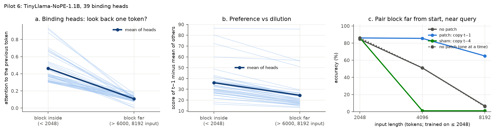

# Pilot 6 results: the toy finding holds in a real 1.1B NoPE model

**Pre-registered verdict: TOY MECHANISM HOLDS IN THE REAL MODEL.** On whether the attention loss comes from a
weaker preference or from dilution, the registered reading is **IN BETWEEN** (margin ratio 0.68).

The verdict is the registered operational label: D1 and D2 hold. It does not show *why* the look-back fades, and
an independent audit ([AUDIT-2.md](AUDIT-2.md)) did not reproduce the margin ratio (finding 4).

In Wang et al.'s TinyLlama-NoPE-1.1B, trained on 2048-token contexts, the heads that make each value token look
back at its key lose most of that look-back once the pairs sit past the trained length. Overwriting those heads'
output with the key's value vector, an oracle patch, brings retrieval over 512 candidate words back from 6.5% to
65% at 4× the trained length, and from 51% to 85.5% (the in-range level) at 2×. Patching the same heads to copy
the wrong token instead destroys retrieval.

Plan: [PREREGISTRATION-6.md](PREREGISTRATION-6.md) (signed commit `01c0d03`, before any data). The feasibility
gate passed (`546760a`), and the user approved the main test before it ran. Decision:
[results6/decision.md](results6/decision.md). Compute: about 1 GPU-hour on one RTX 3090 (≈ $0.30).



## Setup in one paragraph

The model is the published `AntNLP/TinyLlama-NoPE-1.1B`, run with a small forward pass of its own. On one English
paragraph it picks the same next token as the Hugging Face reference at every position (pilot 5), and the second
audit's independently written float32 forward pass matched it exactly on a short paragraph. Each input hides a
block of 16 ` key value` word pairs inside the passkey-style filler that Wang et al. used, and ends with one of the
keys; the model must produce its value. Inputs are 2048 tokens, or 4096 / 8192 with extra filler. The main condition puts
the extra filler *before* the block, so the block ends up far from the start but stays as close to the query as in
training.

## What was found

| "before" placement (block far from start, near query) | 2048 (trained) | 4096 | 8192 |
|---|---|---|---|
| no patch | 84.5% | 51.0% | 6.5% |
| **patch**: binding heads copy the token before (the key) | 86.0% | **85.5%** | **65.0%** |
| sham: same heads copy the token 4 back | 86.0% | 1.0% | 1.0% |

Accuracy is over the 512 value words, 200 inputs each. Over the whole vocabulary it is lower: at 8192 the patch
reaches 25.5% (none 1.0%), and at 4096 none / patch / sham reach 21.5 / 52.0 / 0%.

1. **Binding heads exist in the real model.** 39 of its 704 heads, mostly in layers 11–14, send ≥ 0.3 of a value
   token's attention to the key just before it (mean 0.46) when the block is inside the trained range. The heads
   were selected and their inside attention measured on the same 64 inputs, so 0.46 is selection-conditioned.
2. **Their look-back collapses far away.** With the block past position 6000, that attention falls to 0.11 on
   average (range 0.005–0.19). D1 holds.
3. **An oracle overwrite at these heads restores retrieval.** At 8192 the patch adds +58.5 pp (paired bootstrap
   95% CI +52 to +65.5). At 4096 it adds +34.5 pp (+27.5 to +41.5), back to the in-range level. The wrong-token
   sham collapses accuracy, so the gain comes from restoring the *right* information. D2 holds. The 4096 inputs
   carry a small filler-text confound (Limitations); the audit's own inputs avoid it and still show the 4096 rescue.
4. **Preference or dilution: in between, and not robust.** The score margin of the previous token over the average
   other token falls from 36.1 to 24.5 (ratio 0.68; per head, a median of 0.64, and none below 0.5). The preference
   weakens but is far from erased. An advantage that large over the *average* token would still dominate if the
   other tokens scored evenly, so the lost attention most likely goes to a few strongly scoring tokens. The second
   audit's independent sample (4 inputs, with its own word pools and random draws) found no margin decline at all:
   30.9 → 34.7, ratio 1.12 (95% CI 0.95–1.44), which the registered rule would call PREFERENCE KEPT. In that sample
   the previous token went from usually the top-scoring token (mean rank 1.4) to a mean rank of 27, and
   beginning-of-sequence attention stayed below 0.5%, so the "attention sink" is an unlikely destination. The
   margin decline is therefore an observation about this run's inputs, not a reproduced property, and an average
   margin cannot separate dilution from stronger competitors in any case. Where the attention goes was not
   measured in the registered run.
5. **A second failure the patch does not touch.** With the block early and far from the query ("after"
   placement), accuracy also collapses (2% at 8192), and the patch changes nothing there: the block lies inside
   2048, so nothing was patched. This failure lies in computation the patch does not reach. One hypothesis is the
   query's long-distance look-up; that was not tested. The toy models showed the same split.
6. Uniform placement sits in between: the patch adds +13.0 pp at 4096 and +35.5 pp at 8192.

## How this changes the overall story

The toy result from pilot 4 now has a counterpart in a real, published NoPE language model, under a pre-registered
test with a sham control: the binding heads' look-back fades past the trained length, and an oracle overwrite at
those heads recovers most of the lost retrieval. Wang et al. (2024) explain NoPE's long-context failure as attention
distraction and fix it with attention scaling. These results identify a specific set of heads at which an oracle
overwrite helps on this task. They do not show that these heads are the only bottleneck, or why their look-back
fades. Whether Wang et al.'s scaling works *through* these heads was not tested; it is the natural next question.

## Limitations

- **Oracle intervention.** The patch tells 39 heads exactly where to look. It identifies heads at which an oracle
  overwrite improves this task; it does not show they are the only bottleneck, and it is not a method.
- **One model and a synthetic task** with repetitive filler. Natural documents may behave differently. Accuracy is
  over 512 candidate words; over the whole vocabulary the patched model reaches 25.5% at 8192.
- **The margin measure** compares the previous token with the *average* token, so it cannot show where the lost
  attention goes, and the audit did not reproduce its decline (finding 4). It also departs from its registered
  definition: the code counts the value token itself among the "other earlier tokens" and divides by t instead of
  t − 1. On one matched input this barely moves it (38.77 vs 38.81 inside; 26.82 both far); the 64-input D1b was
  not recomputed.
- **Attention precision.** The measurement hook rounds the attention scores to bfloat16 before the softmax, which
  the model's own attention does not. Reported attention, and which heads clear 0.3, can differ slightly from the
  model's actual attention. The size of this on the 39 heads was not measured.
- **The 4096 inputs change some filler text.** The filler sentence repeats every 24 tokens. Adding 2048 tokens
  before the block (not a multiple of 24) cuts the filler at a new point, so the text between block and query is
  the same sentences shifted by 8 tokens, not identical text; the distance to the query is unchanged. At 8192 the
  extra 6144 tokens are a multiple of 24 and the text is identical, so D2 is unaffected.
- **Numerics.** The registered code scored the unpatched model in batches of 4 and the patched ones one at a time.
  bfloat16 rounding differs slightly by batch size: at 2048, where the patch is the identity, 86.0% vs 84.5%. A
  post-hoc rerun one input at a time (`pilot6_batch1.py`, [results6/none_batch1.json](results6/none_batch1.json))
  gives 86.0% at 2048, 51.0% at 4096 and 6.0% at 8192, so the like-for-like gain at 8192 is +59.0 pp (CI +52 to
  +65.5). These matched baselines are the better effect sizes. Some predictions change; no registered criterion
  does.
- Block size (16 pairs) was chosen on in-range inputs only. This is a local signed pre-registration, not an
  independent timestamp. The model was downloaded by name without recording a revision, so the exact checkpoint
  the GPU run used is not on record.

## Independent audit

A second Codex audit ([AUDIT-2.md](AUDIT-2.md), checks in `audit2/`) re-implemented the model, task, head
selection, measurements, patch and sham from the registrations alone, and ran them in float32 on a laptop CPU. Its
judgment: partly sound.

- **Reproduced:** binding heads (34, all among the original 39); look-back falling past the trained length (0.47 →
  0.17); and the 4096 rescue: none 10/18, patch 18/18, sham 0/18, so patch − none is +44.4 pp (95% CI +22.2 to
  +66.7), with no input harmed.
- **Not reproduced:** the margin decline (finding 4). At 8192 it patched only 2 inputs (both rescued), too few to
  confirm D2; the 200-input 8192 result was not rerun.
- Both saved verdicts reproduce from the saved data, and no error it found flips one. Its other findings are the
  limitations above, plus decision thresholds that compared rounded floats and could fail exactly at a boundary.
  Those now compare integer counts (`pilot6.py`, `report5.py`, `report6.py`); the decision files are unchanged.

## Reproduce

```bash
python pilot6.py --stage tune          # chooses k on 2048-token inputs only
python pilot6.py --stage feasibility   # the gate
python pilot6.py --stage full          # binding heads, margins, patch and sham
python pilot6_batch1.py                # post-hoc: unpatched baseline one input at a time
python report6.py                      # results6/decision.md and fig13
```
