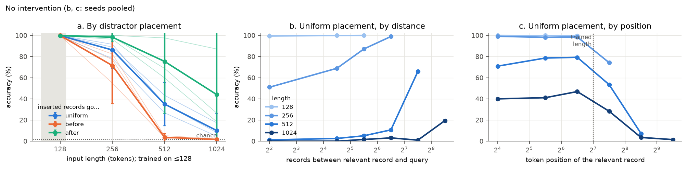
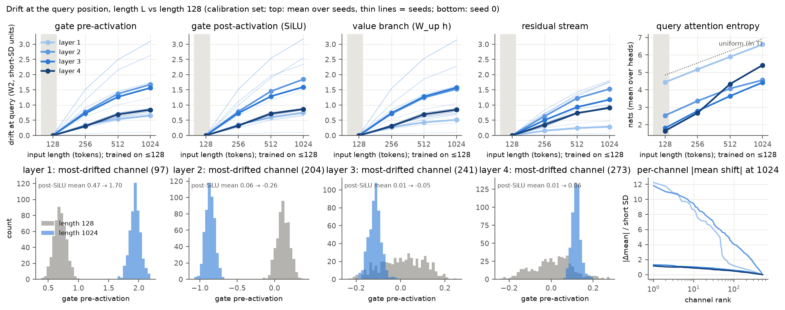
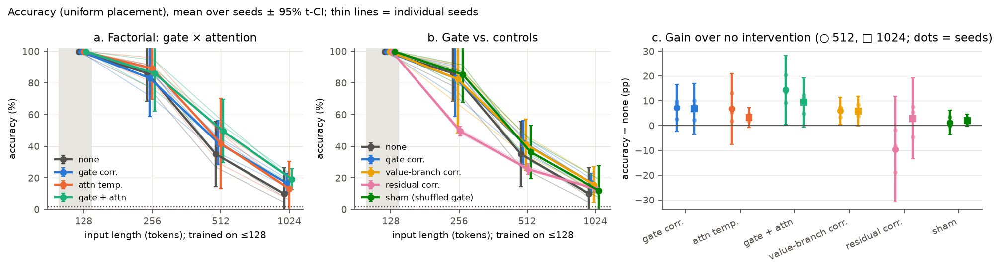
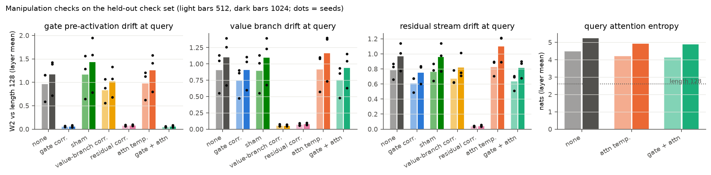
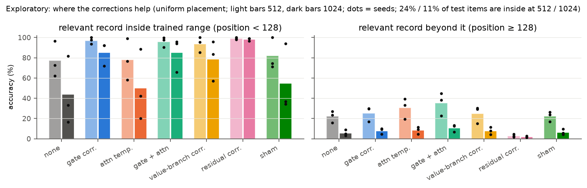

# Results: does SwiGLU gate drift cause length-generalization failure?

**Verdict under the pre-registered rule: ABANDON the gate-alignment proposal.** The gate correction removed
92–96% of the measured gate drift but recovered only about 7 percentage points (pp) of a 65–90 pp accuracy gap.
The same correction applied to the FFN value branch did as well. Both the gate and value corrections clear their
manipulation checks, so this is a clean negative result for the gate-specific hypothesis.

## Question

Inputs longer than the training length shift a Transformer's SwiGLU gate statistics. Does that shift
*causally* contribute to the failure, beyond what attention-side failure explains? The test: repair the gate
statistics at inference time and compare the result with a sham repair, with equivalent repairs elsewhere, and
with an attention-temperature fix, in a factorial design.

## Setup

- **Model:** causal decoder-only Transformer, 4 layers, d = 128, SwiGLU FFN (d_ff 512), **no positional
  embeddings**, 1.13M parameters. Three training seeds (0, 1, 2).
- **Task:** randomized key-value retrieval `BOS k1 v1 … kn vn Q kq → v`. There are 512 keys and 64 values, with a
  fresh mapping for every input (chance = 1.6%). Training uses ≤ 128 tokens with a length curriculum. Paired test
  inputs at 128/256/512/1024 tokens insert irrelevant records while keeping the answer: 1000 base examples, under
  three placements of the inserted records (uniform, before the relevant record, after it).
- **Interventions (inference only):**
  - *gate correction:* a per-layer, per-channel, per-token-role mean/SD map on the gate pre-activation, applied at
    positions ≥ 128. It is fitted layer by layer on a separate unlabeled calibration set.
  - *attention temperature:* logits × max(1, ln(t+1)/ln 128). This policy was fixed in advance and never tuned.
  - *both* combined.
  - Controls: the same map on the **FFN value branch** and on the **residual stream**, and a **sham** (the gate
    map's adjustments applied to shuffled channels).
- **Pre-registration:** every analysis choice and the decision rule were committed, signed, before any long-length
  result (`2e2a272`). There is one amendment, decided on length-128 data only (`21bef95`): the length curriculum,
  because without it the model never learned the task. Compute was 0.76 GPU-hours on one rented RTX 3090 (about
  $0.15).

## 1. The model solves the training length and fails beyond it

Accuracy is 99.8% at 128 tokens, then 86%, 35% and 10% at 256, 512 and 1024. The failure follows **where the
relevant record sits, not its distance from the query**. Inserting the irrelevant records *before* it (distance
unchanged, record pushed past position 128) gives 3.7% at 512. Inserting them *after* it (the record stays early
but the distance grows) gives 75%. Accuracy falls sharply once the relevant record lies past token 128 (panel c).

## 2. Gate statistics do drift with length

At the query position and length 1024, gate pre-activations move by 0.65 / 1.68 / 1.56 / 0.84 short-input SDs
(W2, layers 1–4). Some channels shift by more than 10 SDs, so their short and long histograms do not overlap. The
value branch and residual stream drift by similar amounts. Query attention entropy grows with length in every
layer (layer 4: 1.65 → 5.42 nats).

## 3. The pre-registered test

Accuracy (%), uniform placement: mean over seeds, with seeds 0, 1, 2 in parentheses.

| condition | 256 | 512 | 1024 |
|---|---|---|---|
| none | 86.2 (78, 92, 89) | 35.1 (27, 35, 43) | 10.0 (5, 8, 17) |
| gate correction | 83.0 (72, 90, 87) | 42.2 (36, 45, 46) | 16.8 (15, 16, 20) |
| attention temperature | 89.2 (80, 96, 91) | 41.9 (29, 48, 49) | 13.2 (6, 13, 20) |
| gate + attention | 86.0 (75, 94, 88) | 49.5 (40, 56, 53) | 19.3 (17, 19, 22) |
| value-branch correction | 82.4 (67, 92, 89) | 41.0 (34, 42, 47) | 15.9 (13, 13, 21) |
| residual correction | 49.5 (48, 51, 50) | 25.5 (25, 27, 24) | 12.9 (12, 14, 13) |
| sham | 85.4 (78, 91, 87) | 36.3 (30, 35, 44) | 12.0 (8, 9, 19) |

Every condition scores 99.8% at length 128, where it is the identity by construction.

| criterion (both 512 and 1024; every seed's bootstrap CI > 0) | 512 | 1024 | |
|---|---|---|---|
| G1 gate − none ≥ 10 pp | +7.1 | +6.8 | **fail** |
| G2 gate − sham ≥ 5 pp | +5.9 | +4.8 (seed 2: +0.3, CI includes 0) | **fail** |
| G3 gate − value branch ≥ 5 pp, and gate − residual ≥ 5 pp | +1.2 / +16.7 | +0.9 / +3.9 | **fail** |
| G4 (gate + attention) − attention ≥ 5 pp | +7.6 | +6.2 | pass |

The gate correction helps a little, and it adds a little on top of attention temperature (G4). But the gain is
small, not reliably larger than the sham, and **not specific to the gate**: correcting the value branch instead
gives the same gain within about 1 pp. Full per-seed numbers with bootstrap CIs are in
[results/decision.md](results/decision.md).

## 4. The corrections did what they were meant to do

On a held-out check set, the gate correction cut query-position gate drift from 0.59–1.42 to 0.04–0.09 in every
seed and length (92–96% reduction). The value-branch and residual corrections cut their own targets by more than
90%. The attention policy lowered query entropy only partly (for example, seed 0 at 1024 went from 5.80 to
5.27 nats, against 2.96 at length 128). The negative result is therefore not a failed manipulation. One telling
detail: the residual correction removes almost all drift at the gate, value and residual sites, yet it *lowers*
accuracy at 256 and 512. Restoring the statistics did not restore the computation.

## 5. Exploratory, not pre-registered: where the corrections help

Splitting the uniform-placement test items by the relevant record's position shows two different failures:

- **Record inside the trained range** (11% of items at 1024). The unmodified model still drops to 44% at 1024,
  so reading out an in-range record breaks at long lengths. Every FFN-side correction largely repairs this:
  residual 98%, gate 85%, value branch 79%. Attention temperature barely helps (50%). Under the "after" placement
  ([fig. 5](figures/fig5_placement.png)), gate correction gives 85% and residual correction 99% at 1024, against
  44% unmodified.
- **Record beyond position 128** (89% of items at 1024). Nothing restores it. The best condition is gate +
  attention at 11%. The residual correction pushes these items to 2%.

One hypothesis, not tested here: a model without positional embeddings has to bind each value to the key just
before it using an implicit position signal, and past 128 that signal is out of range. If so, the information is
missing, not merely rescaled, and a per-channel statistics match cannot bring it back. This fits the design
review's objection that matching marginal distributions does not guarantee an activation keeps its meaning.

## Limitations

- One tiny model, one synthetic task, and only the no-positional-embedding (NoPE) setting. A second positional
  scheme (for example RoPE) was out of scope by design.
- Training needed a length curriculum (amendment A1), which may shape the mechanism the model learned.
- Corrections are per-channel affine maps (mean/SD), pooled over positions ≥ 128 within each token role.
  Quantile and position-dependent maps were not tried. That the residual correction *hurts* argues against a
  scale-only explanation, but it does not rule out a richer correction.
- The corrections use unlabeled long-input calibration data. They are a favorable diagnostic, not a deployable
  method.
- Three seeds give wide seed-level t-intervals (df = 2). The rule relies on per-seed paired bootstrap CIs plus
  thresholds. Seed 2 degrades less and gains less than seeds 0 and 1.
- The sham's perturbation came out 1.2–1.6× larger than the real correction's, because it is re-fitted under its
  own upstream changes. It was not exactly size-matched.
- No activation patching or probing, so the exploratory explanation in §5 is a hypothesis.

## Relation to prior work

- **GLU variants (Shazeer, 2020).** The "gate" here is SiLU(W_gate h) in SwiGLU. It is unbounded, so it is not
  an on/off switch, and correcting it is just one of several equally plausible FFN-side corrections. That is what
  G3 found.
- **LM-Infinite (Han et al., NAACL 2024)** names three length-failure factors: attention-logit explosion at unseen
  distances, attention-entropy explosion, and distinct starting-token features (implicitly encoded absolute
  position). Here attention entropy does explode, but a fixed
  log-length temperature recovers only 3–7 pp. The dominant failure looks position-related: records past the
  trained length are lost even at short distance. That is closer to their implicit-position factor, now in a NoPE
  model.
- **Han & Ji (ACL 2025)** find that attention logits split into roughly additive positional and semantic parts,
  and that length-extrapolation methods work by keeping attention outputs in distribution. The present pilot is
  complementary but small. Forcing FFN and residual statistics back in distribution was not enough when the
  positional part of the computation was itself out of range. Their mechanism (studied in RoPE LLMs) was not
  tested here.
- **Long-Short Alignment (Du et al., ICML 2025)** regularizes output consistency across lengths during training.
  This pilot gives no reason to move that alignment onto the FFN gates: at inference, gate alignment was no better
  than value-branch alignment.
- **Vasylenko et al. (arXiv 2610.04518, Oct 2026)** trace a train/inference pre-activation mismatch to dropout
  placement and propose variance-preserving affine dropout. Our model uses no dropout, and the short-vs-long shift
  studied here is a different mismatch. Correcting it at inference was not sufficient.
- **Novelty is modest.** I am not aware of this exact gate-vs-control factorial in prior work, but I have not
  searched exhaustively, and it is a small diagnostic, not a method.

## What would come next

By the pre-registered rule the gate-alignment idea is dropped. The exploratory split points to a different
question: how a Transformer loses track of records placed beyond its trained length. That question would need its
own pre-registered test. Steps would be confirming the inside-vs-beyond split with a RoPE model, checking with
probes whether key identity is still decodable at out-of-range value positions, and patching activations from
in-range positions.
